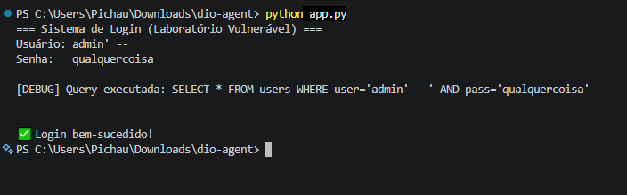
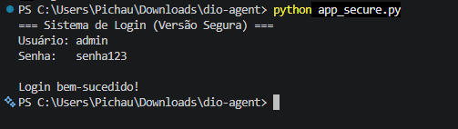
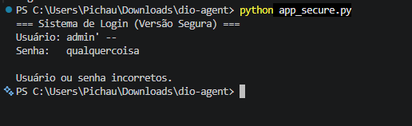
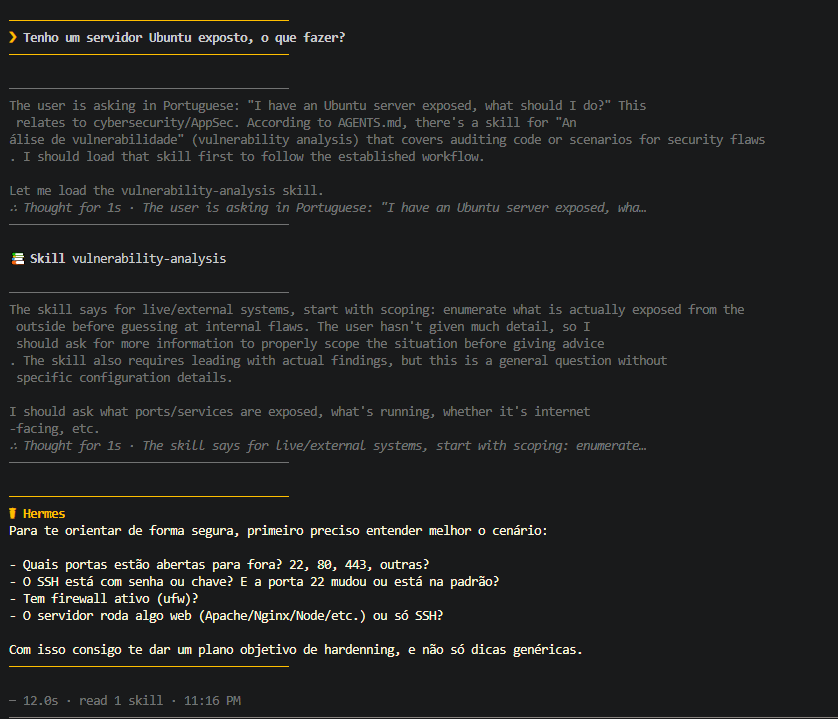
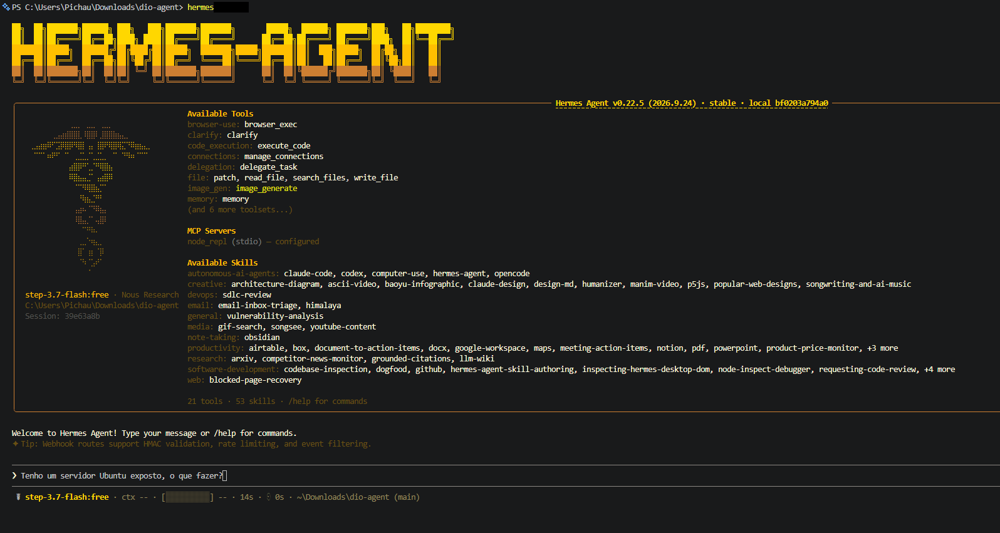

# DIO Agent — Especialização em Cibersegurança (AppSec)

Projeto desenvolvido durante o Desafio de Projeto da [DIO](https://dio.me) sobre criação e especialização de agentes de inteligência artificial.

Neste projeto, evoluí o **DIO Agent** para atuar como um mentor especialista em **Cibersegurança e Application Security (AppSec)**. Em vez de simplesmente entregar respostas prontas ou gerar comandos invasivos sem critério, o agente analisa vulnerabilidades com mentalidade defensiva, entende o contexto antes de agir, avalia riscos e conduz o estudante na correção do código.

---

## 🎯 Por que essa especialização?

No desenvolvimento de software, muitos erros de segurança acontecem porque quem programa não aprendeu a pensar como um atacante. A ideia desta especialização foi criar um mentor que ajude a desenvolver uma visão preventiva (DevSecOps), ensinando a identificar falhas graves — como SQL Injection e exposição de credenciais — e a corrigi-las de forma estruturada.

---

## 📁 Arquivos Criados e Alterados

Para ensinar essa habilidade ao agente sem treinar nenhum modelo (usando apenas engenharia de contexto via arquivos), estruturei o projeto da seguinte forma:

| Arquivo | Tipo | Função no Projeto |
|---|---|---|
| `skills/vulnerability-analysis/SKILL.md` | **Criado** | Roteiro de 6 passos que guia o agente durante a análise de uma vulnerabilidade. |
| `skills/vulnerability-analysis/README.md` | **Criado** | Documentação explicando como e quando utilizar a skill. |
| `agent/knowledge/security-basics.md` | **Criado** | Base de conhecimento com conceitos essenciais: Tríade CIA, OWASP Top 10, CVSS, MITRE ATT&CK e boas práticas. |
| `agent/persona.md` | **Alterado** | Adição da postura de especialista em segurança (perguntar o contexto antes, não criar exploits e guiar o raciocínio). |
| `AGENTS.md` | **Alterado** | Registro da nova skill na tabela oficial para o harness saber quando acioná-la. |
| `app.py` | **Criado** | Código de laboratório com falha intencional de SQL Injection e senha em texto puro para testes. |
| `app_secure.py` | **Criado** | Versão corrigida e segura utilizando consultas parametrizadas e hash de senha com `bcrypt`. |

---

## 🛠️ Como Rodar o Agente

O agente foi configurado para rodar através do harness **Hermes Agent**.

### 1. Pré-requisitos
Ter o Python e o Hermes instalados na máquina:
```powershell
iex (irm https://hermes-agent.nousresearch.com/install.ps1)
```

### 2. Executando no terminal
Abra o terminal do VS Code **dentro da pasta do projeto** (obrigatório para que o Hermes carregue as skills locais):
```powershell
cd caminho/para/dio-agent
hermes
```

### 3. Exemplos de prompts para testar
- **Análise de código:**  
  `"Analise o arquivo app.py como um especialista em AppSec e me aponte as falhas de segurança sem me dar o código pronto."`
- **Análise de cenário/infraestrutura:**  
  `"Quero analisar uma vulnerabilidade. Tenho um servidor Ubuntu exposto na internet. Não sei por onde começar."`

---

## 💡 A Melhoria Escolhida: Relatório Padronizado de Análise

Como melhoria em relação ao modelo base apresentado nas aulas, defini na skill que toda análise finalizada deve gerar um **Relatório Padronizado de Análise de Vulnerabilidade**.

Esse relatório avalia:
- **Classificação OWASP** e Mapeamento para **MITRE ATT&CK**;
- **Impacto, Probabilidade e Severidade** (baseado na metodologia CVSS);
- **Pilares da Tríade CIA afetados** (Confidencialidade, Integridade e Disponibilidade);
- **Orientação de correção defensiva**.

Dessa forma, o resultado sai sempre no mesmo formato profissional, facilitando a comparação entre diferentes cenários e código.

---

## 📸 Evidências dos Testes Práticos

Para validar todo o fluxo, realizei os testes tanto na aplicação quanto no comportamento do agente:

### 1. Teste no Terminal: Ataque vs Código Seguro
No laboratório prático, validei a exploração da falha e a posterior correção:

- **Código Vulnerável (`app.py`):** O ataque com payload `admin' --` ignora a checagem de senha e faz o bypass do login com sucesso.
- **Código Mitigado (`app_secure.py`):** O mesmo ataque é bloqueado com *"Usuário ou senha incorretos"*, e o acesso só é permitido com a credencial legítima.

#### Teste do código vulnerável:


#### Teste do código seguro com credencial válida:


#### Bloqueio do ataque de SQL Injection:


---

### 2. Comportamento do DIO Agent no Hermes
Ao testar o agente no terminal com o cenário do servidor exposto, ele demonstrou a postura correta esperada de um profissional: **não sugeriu comandos precipitados** e primeiro perguntou sobre o nível de acesso e o contexto do ambiente.

#### Agente solicitando contexto antes de agir:


#### Reconhecimento e carregamento autônomo da skill no Hermes:


---

## 👨‍💻 Autor

Projeto desenvolvido por **Gustavo Rosário Nunes** para o Desafio de Projeto da DIO.
